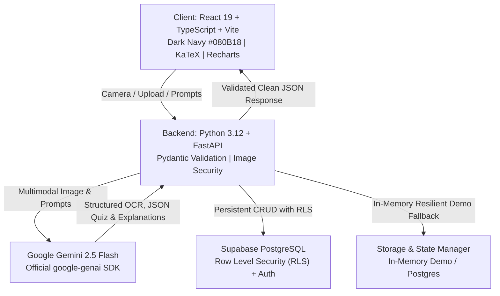

# Snap2Learn AI — System Architecture

**Tagline:** Snap. Understand. Practice. Master.  
**Focus:** First-Year CSE & AIML Engineering Education

---

## 1. High-Level System Architecture

---

## 2. Core Subsystems

### 2.1 Multimodal Scanner Pipeline
1. **Client Capture:** User activates camera via `navigator.mediaDevices.getUserMedia` or uploads a local file (JPEG, PNG, WebP).
2. **Client Validation:** File size limit checked (max 10MB) before transmission.
3. **Server-Side Verification:** FastAPI validates MIME headers and executes Pillow verification (`Image.open().verify()`) to prevent malicious payload injections.
4. **Gemini Vision Processing:** Transcribes handwritten text, formulas, diagrams, identifies academic subject and chapter topic, flags uncertain handwriting segments.
5. **Confirmation UI:** Student reviews transcription in an editable panel with LaTeX preview before triggering downstream AI tasks.

### 2.2 Multi-Tier Explanation Engine
- **Modes:**
  - `Beginner`: Analogies, simplified terminology, intuitive foundations.
  - `Standard`: Rigorous university textbook definitions and complete proofs.
  - `Exam Preparation`: Structured 5-mark and 10-mark model answers formatted for semester exams.
- **Languages:**
  - `English`: Standard technical English.
  - `Telugu (తెలుగు)`: Authentic Telugu script with technical terms in parentheses.
  - `Bilingual`: Side-by-side presentation to bridge state board students into English medium education.
- **Mathematical Equations:** Rendered using client-side KaTeX (`$..$` and `$$..$$`).

### 2.3 AI Quiz Arena & Deterministic Evaluation
- Generates 5, 10, or 15 multiple-choice questions grounded in confirmed study notes.
- Question structure validated via Pydantic schemas.
- **Security & Integrity:** Answer keys are stored server-side. The client view (`QuestionClientView`) omits `correct_index` and explanations during test taking.
- **Scoring:** Computed deterministically in application code (`correct_count / total * 100`).
- **Review:** Displays question-by-question explanations and flags weak topics for progress tracking.

### 2.4 Smart Flashcards & Analytics
- Flashcards engine with 3D flip card animations and spaced repetition ratings (Easy, Medium, Hard).
- Progress Analytics calculates average quiz accuracy, subject mastery distribution, and study streaks using Recharts.
